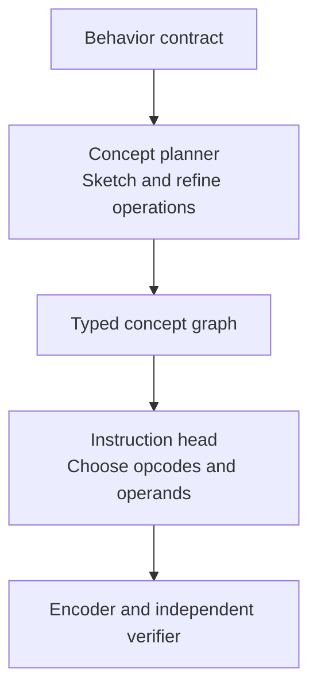
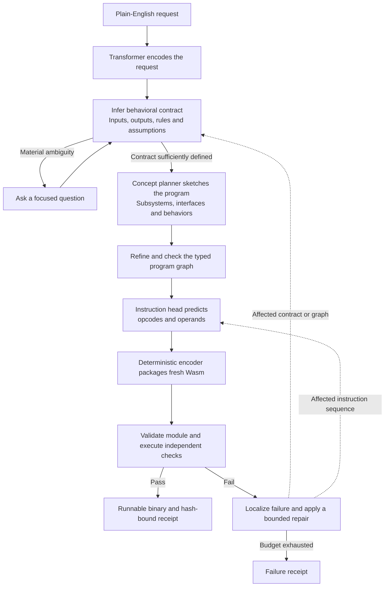
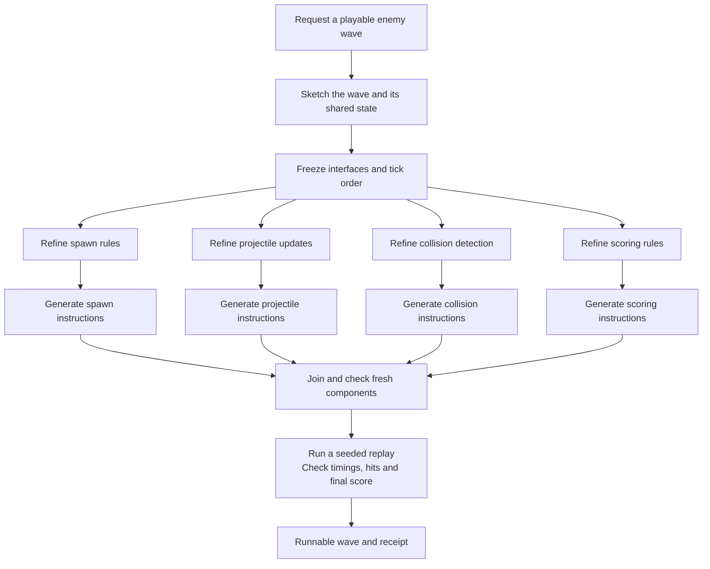
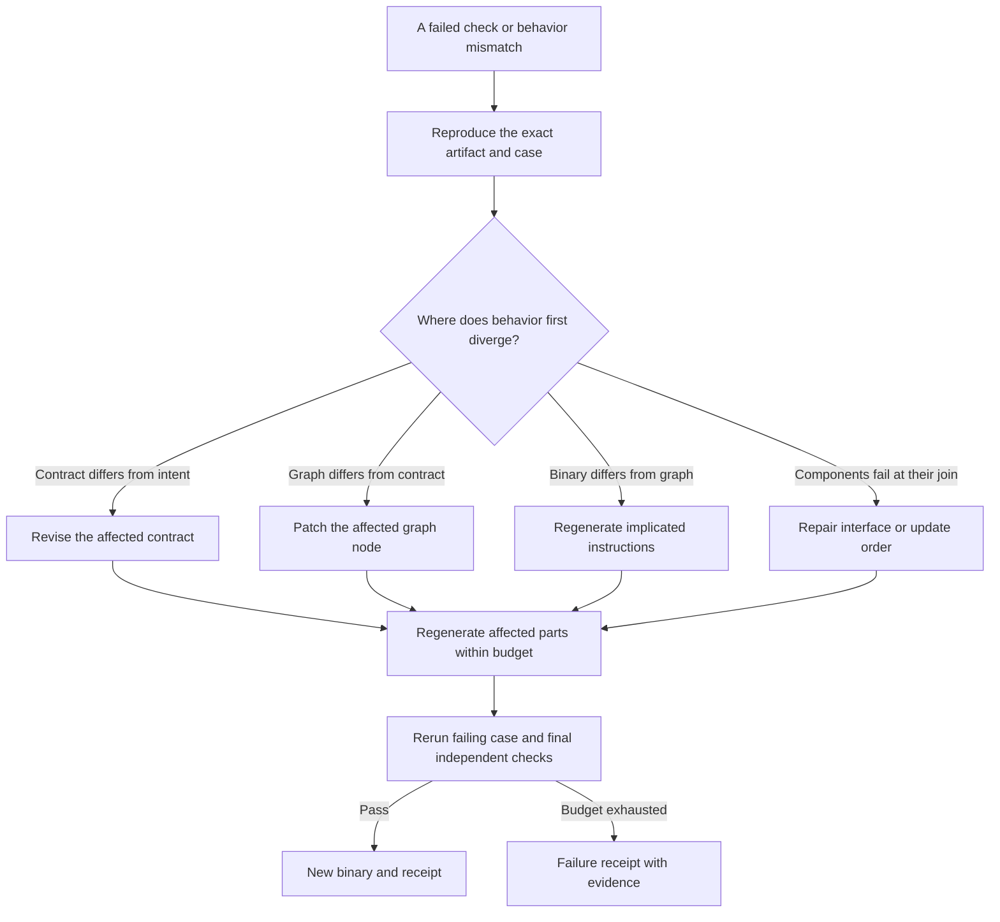
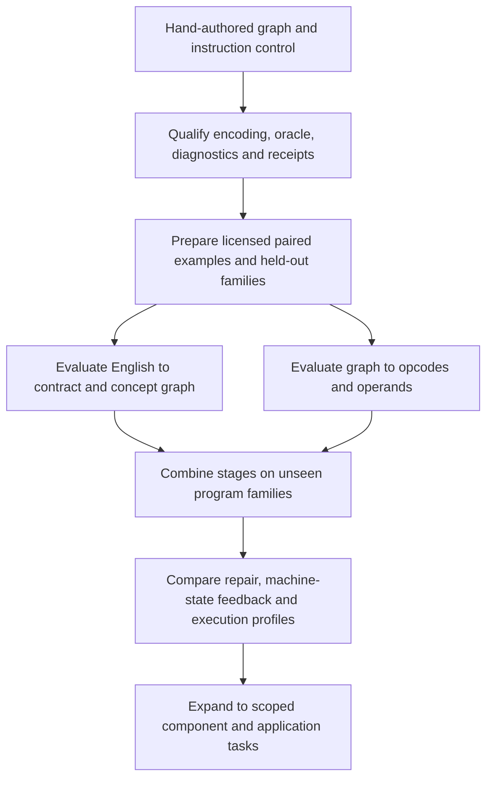
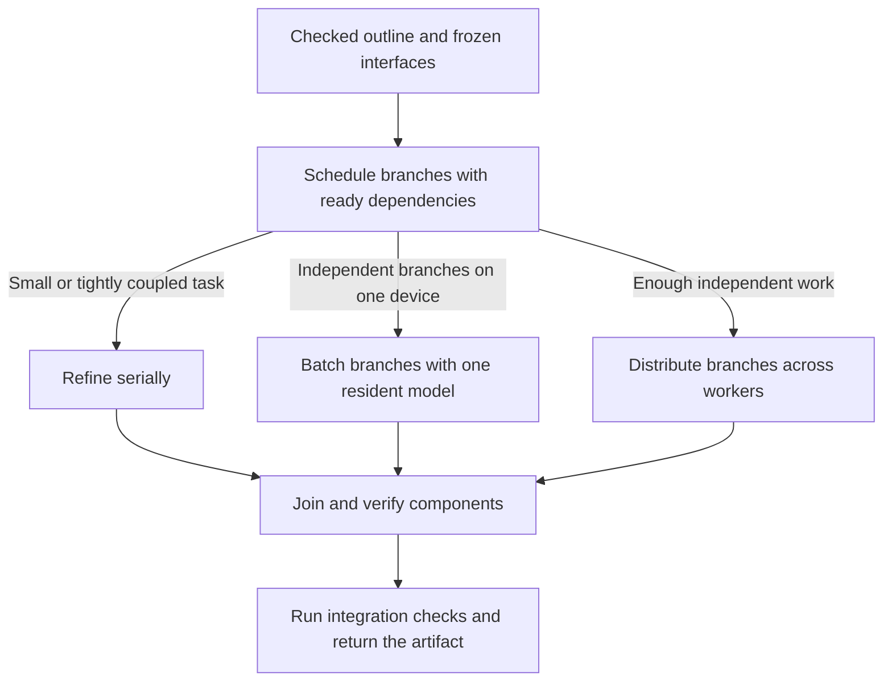

# L.O.R.E.

**Research on typed program concepts, learned instructions, and verified executables.**

L.O.R.E. is an independent research project by **Kian Konrad Tajbakhsh**. The goal is to turn a plain-English request into an executable by reasoning through a typed program graph, generating its instructions, and returning a binary with evidence from an independent test run.

The research program investigates verified task completion, end-to-end latency, and compute per correct result. It connects a defined architecture, explicit evaluation criteria, and an executable control. The next experiments evaluate learned graph and instruction generation against matched baselines.

[Subsystem guide](docs/Subsystems.md) · [Architecture](docs/Architecture.md) · [Research foundations](docs/Research_Foundations.md) · [Try the demo](docs/Try_It.md)

## The building blocks

**Next-Concept Modeling (NCM)** is published research on generation through a learned hierarchy of discrete codes. L.O.R.E.'s proposed concept planner uses explicit typed program operations. The visual guide explains the relationship between these two hierarchies. [Concepts, codes and tokens](docs/Concept_Hierarchy.md)

| Subsystem | Responsibility | Visual explanation |
| --- | --- | --- |
| Concept planner | Compose and refine the program's concepts | [NCM and program concepts](docs/Subsystems.md#1-ncm) |
| Typed graph | Make values, relationships and constraints explicit | [Graph and joins](docs/Subsystems.md#2-the-typed-graph) |
| Instruction head | Propose executable operations for the checked graph | [Instruction generation](docs/Subsystems.md#3-the-instruction-head) |
| Encoder | Serialize instructions and preserve graph origins | [Binary encoding](docs/Subsystems.md#4-the-deterministic-encoder) |
| Verifier | Compare execution with independent expectations | [Checks and receipts](docs/Subsystems.md#5-the-verifier-and-receipt) |

## The system we want to build

### 1. English to a tested executable

This diagram shows the proposed end-to-end system. The pilot has exercised encoding, verification, and diagnostic controls with a hand-authored graph and instruction fixture.

A model would first make the requested behavior explicit, then decompose the program into typed operations and interfaces. A later instruction head would predict the opcodes and operands for those checked operations. A deterministic encoder would package them into WebAssembly. The runner would check the module and compare its behavior with separately authored expectations.

### 2. Parallel generation for a game wave

This future example shows how separate components would meet at checked interfaces before a seeded integration replay.

### 3. Debugging through contracts, graphs and instructions

Failures would be localized before regenerating affected parts. Every proposed repair still has to pass independent checks within its budget.

### 4. Pilot, learning and evaluation sequence

The hand-authored control has reproduced locally. The learned stages and broader applications are research objectives.

### 5. Execution profiles

The project would compare these scheduling choices at matched correctness and resource budgets.

## Why structure the program this way?

The graph gives the system explicit boundaries to check before execution. It also creates a place to localize a failure, regenerate the affected component, and check whether independently generated branches fit together.

For larger tasks, the proposal is to freeze interfaces before refining independent branches. The project would compare serial refinement, batching branches on one model, and distributing branches across workers. Another experiment would test whether bounded feedback about stack, locals, memory, or failed properties improves instruction generation. These choices need measured comparisons. [Detailed architecture](docs/Architecture.md)

## Research foundations

The design connects staged semantic decoding, learned program abstractions, constrained generation, compiler policies, and instruction-level search. The research review maps eight published systems and methods to specific L.O.R.E. decisions, including where their results may transfer and what still needs an experiment. [Read the source comparisons](docs/Research_Foundations.md)

## Research questions

- Does hierarchical concept generation improve verified success on unseen program families?
- Can a learned instruction head generate valid, useful sequences from a checked graph?
- Does execution-state feedback help repair failures within a fixed budget?
- When does parallel branch generation save elapsed time after join and repair costs?
- Can the complete system improve time and compute per correct result against a source-generation baseline?

The program starts with bounded integer functions and grows toward executable components and scoped application build, edit, and debugging tasks. Every expansion has an interface, acceptance criteria, and a comparison designed to test its contribution. [Experiments and decision gates](docs/Research_Plan.md) · [Research foundations](docs/Research_Foundations.md)

## Executable evidence

The CPU pilot produced and tested a 110-byte Wasm module that counts signed 32-bit integers strictly greater than 10. It passed five fixed cases and two deliberate rejection controls, and a clean rebuild reproduced its bytes.

You can try that prebuilt module offline in a browser by downloading this repository and opening [demo/index.html](demo/index.html). Try `11, 11, 10, 11`, which returns `3`. [Worked example](docs/Worked_Example.md) · [Current evidence and limits](docs/Limits.md)

## Give feedback

I'm considering taking L.O.R.E. further and would like a technical second opinion on the whole approach. Which architectural assumption would you challenge? Where would you simplify the design? What existing work should inform it, and what small experiment would convince you to continue or stop?

Reply where I shared the project or [open an issue](https://github.com/Kian-hdr/lore-demo/issues/new). Concrete counterexamples and proposed tests are welcome.

## Technical disclosure and access

The architecture and diagrams are prepared for public discussion. Advanced model configurations, training recipes, weights and checkpoints, and core implementation details are confidential and reserved for internal research. Those technical details are redacted from this preview. The learning stages described above are research objectives.

For deeper technical review or an access request, [contact Kian through a GitHub issue](https://github.com/Kian-hdr/lore-demo/issues/new), or reply in the channel where this project was shared. [Disclosure boundary](docs/Access.md)

## Ownership

L.O.R.E. is owned by Kian Konrad Tajbakhsh. Copyright © 2026 Kian Konrad Tajbakhsh. All rights reserved. This repository is a research preview for feedback. The core implementation is proprietary.
