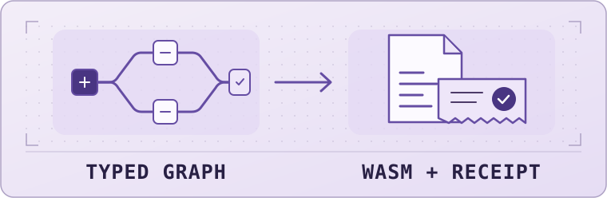

# L.O.R.E. Demo

**This research project explores turning plain-English requests into executables with independently checked results.**

<picture>
  <source media="(prefers-color-scheme: dark)" srcset="docs/images/lore_hero_dark.svg">
  <source media="(prefers-color-scheme: light)" srcset="docs/images/lore_hero_light.svg">
  
</picture>

[Try the demo](docs/Try_It.md) · [Read the architecture](docs/Architecture.md) · [Walk through the example](docs/Worked_Example.md)

## How it works

L.O.R.E. is an independent research project by **Kian Konrad Tajbakhsh**. It explores whether a model could turn a plain-English request into a typed program graph and structured instructions, with a separate check of the resulting executable.

The current pilot starts with a hand-authored graph. An encoder writes WebAssembly bytes from the structured instructions. An isolated verification harness checks the result against separately written expectations. Model-generated graphs and instructions are the proposed next experiment. [Architecture](docs/Architecture.md) · [Current limits](docs/Limits.md)

## Try it

Download or clone this repository, then open [demo/index.html](demo/index.html) from your local files in a browser. Try `11, 11, 10, 11`. The module returns **3** because each `11` counts and `10` is exactly at the threshold. You can enter your own signed 32-bit integers, including negatives, or clear the input to try an empty list. [Instructions and fixture hash](docs/Try_It.md)

## Give feedback

I'm considering taking L.O.R.E. further and would like a technical second opinion on the design. What do you think of the architecture? Where would you simplify it, and what experiment would convince you the approach is worth pursuing?

Reply where I shared the demo or [open a GitHub issue](https://github.com/Kian-hdr/lore-demo/issues/new).

## Ownership

L.O.R.E. is owned by Kian Konrad Tajbakhsh. Copyright © 2026 Kian Konrad Tajbakhsh. All rights reserved. This repository is a research preview for feedback. The core implementation is proprietary.
