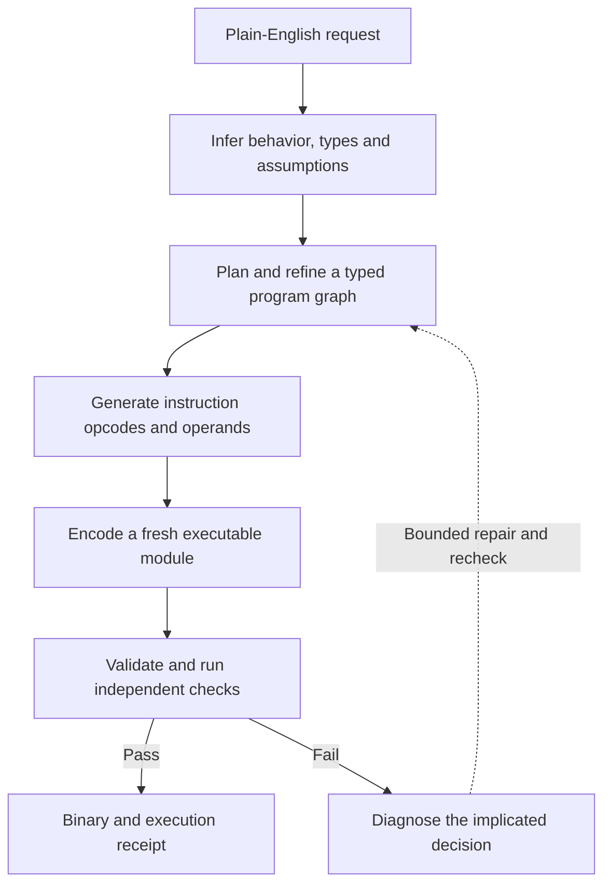

# L.O.R.E.

L.O.R.E. is an independent research project by **Kian Konrad Tajbakhsh**. The goal is to turn a plain-English request into an executable by reasoning through a typed program graph, generating its instructions, and returning a binary with evidence from an independent test run.

The research question is whether this approach can improve verified task completion, end-to-end latency, and compute efficiency compared with generating source code and compiling it. The current evidence is one small hand-authored control. The model-driven system described here is the proposed research direction.

[Project concept](docs/Concept.md) · [Architecture](docs/Architecture.md) · [Research plan](docs/Research_Plan.md) · [Try the pilot](docs/Try_It.md)

## The system we want to build

This diagram shows the proposed end-to-end system. The pilot has exercised encoding, verification, and diagnostic controls with a hand-authored graph and instruction fixture.

A model would first make the requested behavior explicit, then decompose the program into typed operations and interfaces. A later instruction head would predict the opcodes and operands for those checked operations. A deterministic encoder would package them into WebAssembly. The runner would check the module and compare its behavior with separately authored expectations.

## Why structure the program this way?

The graph gives the system explicit boundaries to check before execution. It also creates a place to localize a failure, regenerate the affected component, and check whether independently generated branches fit together.

For larger tasks, the proposal is to freeze interfaces before refining independent branches. The project would compare serial refinement, batching branches on one model, and distributing branches across workers. Another experiment would test whether bounded feedback about stack, locals, memory, or failed properties improves instruction generation. These choices need measured comparisons. [Detailed architecture](docs/Architecture.md)

## What we want to find out

- Does hierarchical concept generation improve verified success on unseen program families?
- Can a learned instruction head generate valid, useful sequences from a checked graph?
- Does execution-state feedback help repair failures within a fixed budget?
- When does parallel branch generation save elapsed time after join and repair costs?
- Can the complete system improve time and compute per correct result against a source-generation baseline?

The path starts with bounded integer programs, then grows toward runnable components and scoped application build, edit, and debugging tasks. Each expansion needs a defined interface and independent acceptance checks. [Experiments and decision gates](docs/Research_Plan.md)

## What exists today

The CPU pilot produced and tested a 110-byte Wasm module that counts signed 32-bit integers strictly greater than 10. It passed five fixed cases and two deliberate rejection controls, and a clean rebuild reproduced its bytes.

You can try that prebuilt module offline in a browser by downloading this repository and opening [demo/index.html](demo/index.html). Try `11, 11, 10, 11`, which returns `3`. [Worked example](docs/Worked_Example.md) · [Current evidence and limits](docs/Limits.md)

## Give feedback

I'm considering taking L.O.R.E. further and would like a technical second opinion on the whole approach. Which architectural assumption would you challenge? Where would you simplify the design? What existing work should inform it, and what small experiment would convince you to continue or stop?

Reply where I shared the project or [open an issue](https://github.com/Kian-hdr/lore-demo/issues/new). Concrete counterexamples and proposed tests are welcome.

## Ownership

L.O.R.E. is owned by Kian Konrad Tajbakhsh. Copyright © 2026 Kian Konrad Tajbakhsh. All rights reserved. This repository is a research preview for feedback. The core implementation is proprietary.
