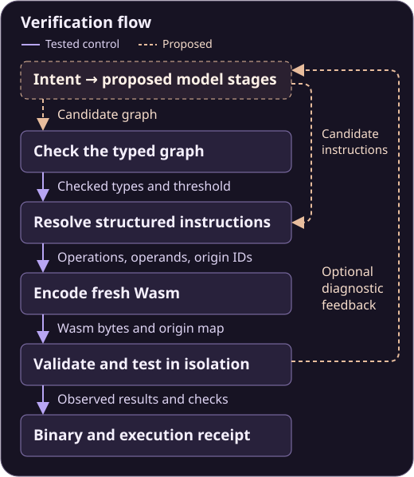

# Architecture

The tested control starts with a hand-authored graph and instruction fixture. The proposed system adds model-produced candidates at those interfaces and could feed structured diagnostics into a bounded retry.

  

*Solid arrows follow the tested control with hand-authored inputs. Dashed arrows show the proposed model and feedback paths.*

## What crosses each boundary

| Boundary | Handoff |
| --- | --- |
| Graph check to instruction fixture | Checked types and threshold. The predicate supplies the Boolean that the counter expects. |
| Instruction fixture to encoder | Structured operations and operands with graph origin IDs. |
| Encoder to verification | Fresh Wasm bytes and an origin map that links instruction byte spans to graph operations. |
| Verification to receipt | Observed counts, resource and rejection checks, and hashes binding the artifact and canonical results. |

The encoder writes the module directly from the fixture. Wasmi independently parses and validates the bytes, checks the module interface, and runs the cases in an isolated worker. The supervisor holds the expected results separately and compares them with the worker's observed counts. These are separate responsibilities within the same pilot harness.

## Where failures stop

- **Graph join.** If a producer returns an integer where its consumer expects a Boolean, the checker reports the two graph endpoints and stops before encoding.
- **Instruction validation.** If the binary reads a local outside the function's declared locals, the validator rejects the module. Its byte offset identifies the instruction's origin in the graph.
- **Execution and oracle.** The runner applies resource limits, and the supervisor compares each count with the frozen expected result. A failing check prevents an accepted receipt.

A future feedback path could send a failed interface, origin ID, or test outcome to the candidate generator for a bounded retry. The pilot exercised the first two diagnostic paths by substituting one deliberate fault at a time and restoring the original fixture. See the [worked example](Worked_Example.md#two-deliberate-failures) for the exact controls.

[Concept](Concept.md) · [Try the demo](Try_It.md) · [Overview](../README.md)
