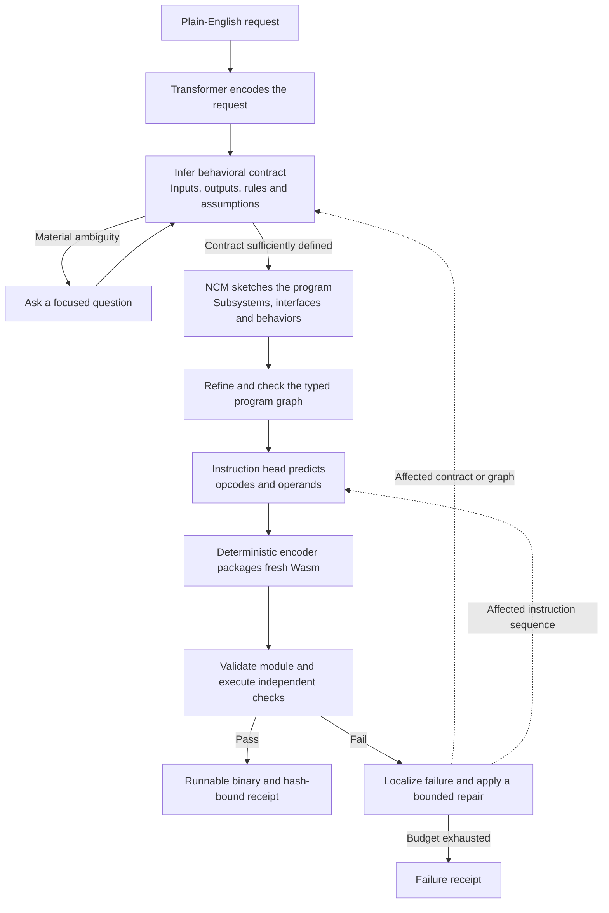
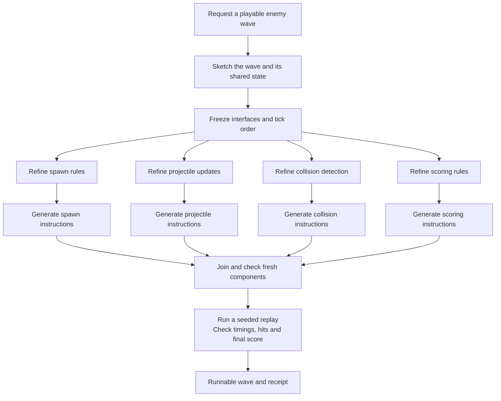
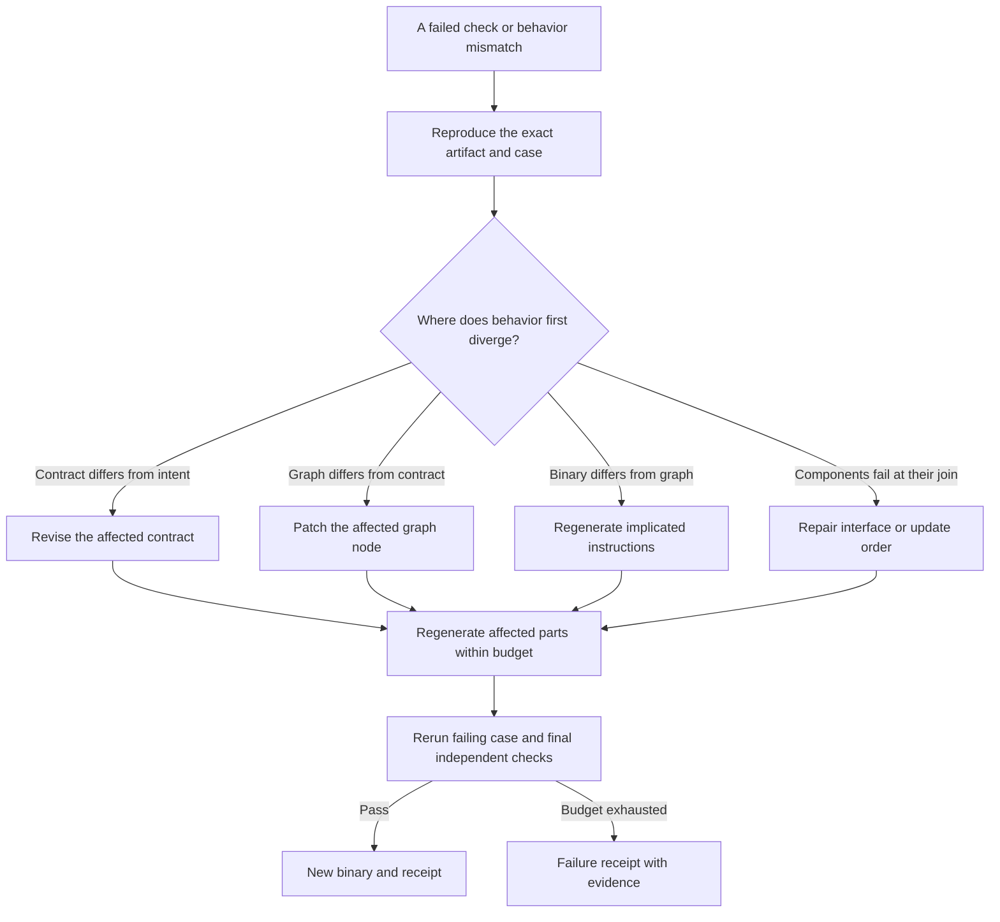
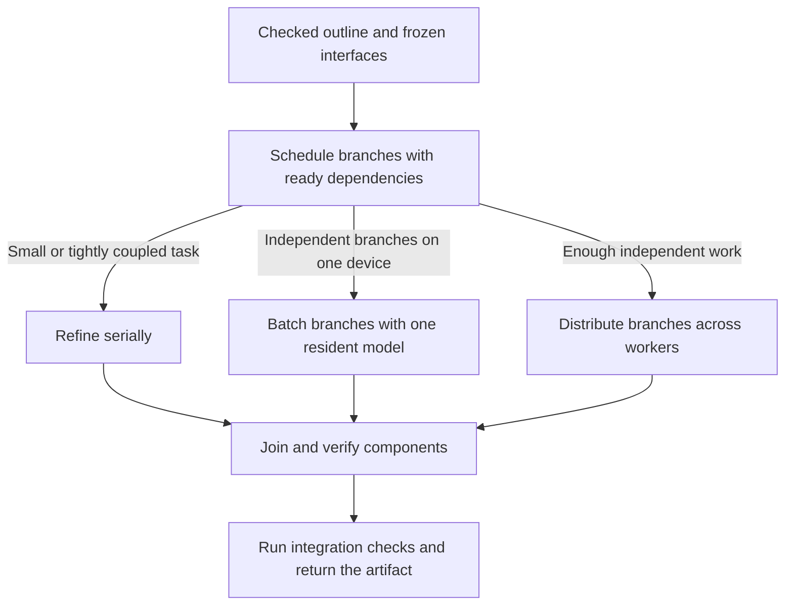
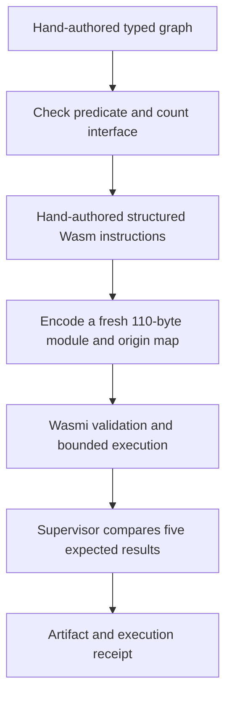

# Proposed system architecture

These Mermaid views adapt the architecture diagrams developed during the project discussion. They describe the proposed full system. The current pilot provides evidence for a small hand-authored control path, detailed at the end of this page.

## From English to a tested executable

The intent and concept stages decide the program's meaning and structure. The instruction stage proposes how to execute it on the chosen target. Whether these stages share one transformer or use separate models is an experimental choice.

| Interface | Information exchanged | Required check |
| --- | --- | --- |
| Intent to graph | Behavior, types, assumptions, bounds and allowed effects | Contract coherence and alignment with caller intent |
| Graph to instruction generator | Checked operations, argument references, interfaces and origin IDs | Complete graph, compatible joins and supported target |
| Instructions to encoder | Structured control flow, opcodes, operands and origin IDs | Valid records and structural references |
| Binary to evaluator | Module, ABI, contract and expected tests | Binary validation, isolation and resource limits |
| Evaluator to receipt | Outcomes, diagnostics, hashes, environment and measurements | Bind the evidence to the exact artifact and test configuration |

Independent tests can reveal intent errors, but their coverage is limited. A valid module can still implement the wrong behavior.

## Coarse-to-fine and parallel refinement

The wave is an illustrative future workload. Branches inherit the root contract and keep their agreed interfaces while they refine their internals. The join checks types, effects, shared-state assumptions, and update order. Work is eligible for parallel execution only when its dependencies permit it.

## Instruction feedback and repair

The optional instruction-level experiment would feed bounded summaries of stack, locals, memory, control flow, or a failed property back to the generator. The behavioral contract remains fixed during that experiment. Compare the generator with and without this feedback using matched latency or compute budgets.

The pilot's two rejection controls demonstrate locations for diagnostics. A person restored the known fixture. Learning a useful repair policy is future work.

## Execution profiles

Measure critical-path rounds, join failures, repair costs, total compute, and wall time. Distribution is a candidate execution profile, whose overhead and consistency costs need evaluation.

## The tested control

The original harness also checked an invalid local instruction and an incompatible graph join. The browser demo runs the prebuilt accepted module with new input values. [Worked example](Worked_Example.md) · [Try it](Try_It.md) · [Evidence limits](Limits.md)

[Project concept](Concept.md) · [Research plan](Research_Plan.md) · [Overview](../README.md)
