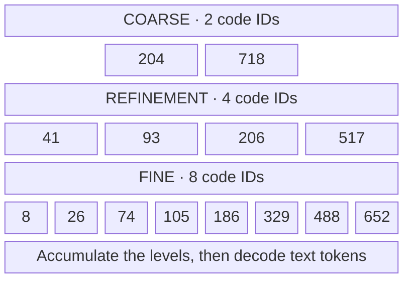
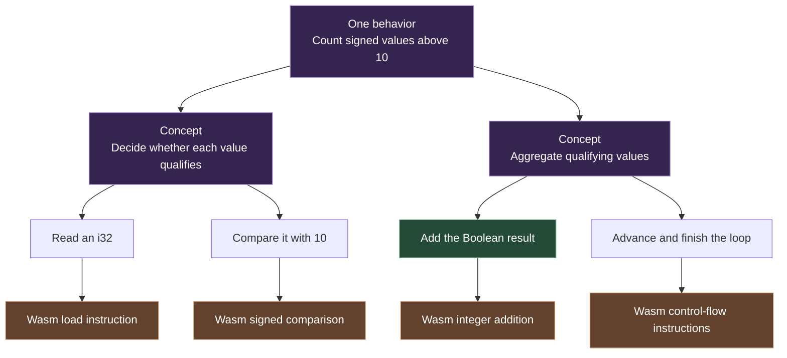

# From broad concepts to fine detail

A hierarchy can represent the same output at several levels of detail. The upper levels use fewer units to capture broad structure. Later levels add detail. The distinction is the granularity of the representation.

## The learned-code pyramid

Published **Next-Concept Modeling**, or **NCM**, learns a multiscale discrete representation of text. Its generator predicts one level at a time, with the positions at each level predicted in parallel. A decoder reconstructs text from the accumulated representation. [Kumbong and colleagues, 2026](https://arxiv.org/abs/2610.14162) · [Author repository](https://github.com/HazyResearch/ncm)

The diagram below is an original schematic. Each tile contains an illustrative numeric code ID. The rows contain 2, 4 and 8 codes. These IDs are examples, not values copied from a trained model.

Read from top to bottom. Fewer coarse codes summarize structure across the sequence. Finer levels supply residual detail, and the completed representation is decoded into tokens. Rows represent refinement levels. An ID names a codebook entry. The number printed in a tile is not a token count or an abstraction score.

## What “more context per token” means here

| Term | What the visual represents |
| --- | --- |
| Text token | A symbol in the output tokenizer's vocabulary |
| Code ID | An index into a learned codebook at a particular level |
| Coarse code | Part of a representation with fewer positions for the sequence |
| Finer code | A contribution at a denser level of detail |
| Model context window | A separate limit on the information the model can attend to |

A code label does not disclose its meaning. The hierarchy lets the representation move from broad structure toward detail. A larger context window or a fixed number of words “inside” each code does not follow from the pyramid alone. [NCM formulation and tokenization](https://arxiv.org/html/2610.14162v1#S3)

## The corresponding idea in L.O.R.E.

For executable generation, L.O.R.E.'s proposed hierarchy uses explicit program meanings. This is a design analogy with the learned-code hierarchy. The roles and representations differ.

The top specifies the task. The middle makes operations and interfaces explicit. The bottom supplies target execution detail. In the pilot, the graph and instructions were hand-authored. Evaluating learned versions is part of the research plan.

The tokenizer, learned codes and text-generation results in the NCM paper belong to its authors. L.O.R.E.'s current demo establishes a typed-program control and an execution path. [Subsystem guide](Subsystems.md) · [Research foundations](Research_Foundations.md)

[Overview](../README.md) · [Architecture](Architecture.md) · [Research plan](Research_Plan.md)

Visual reference for the layered teaching approach: [Cloud X Berry video](https://www.youtube.com/watch?v=SMYzc9FMXj0). The schematics on this page were authored for this explanation, with the mechanism checked against the linked primary research.
