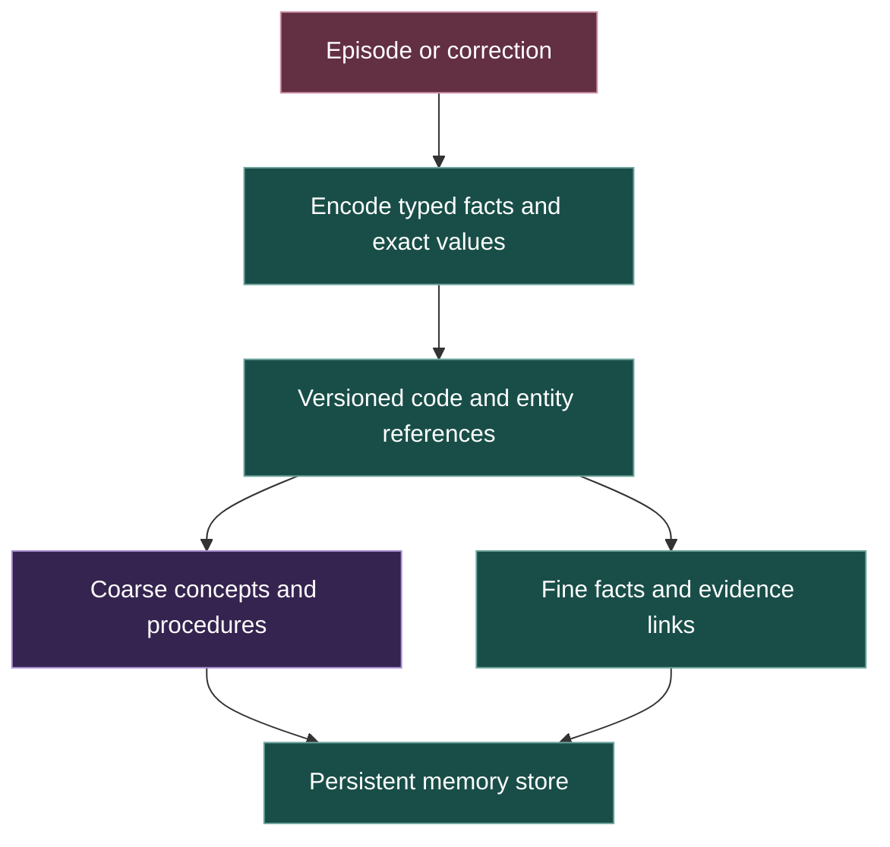
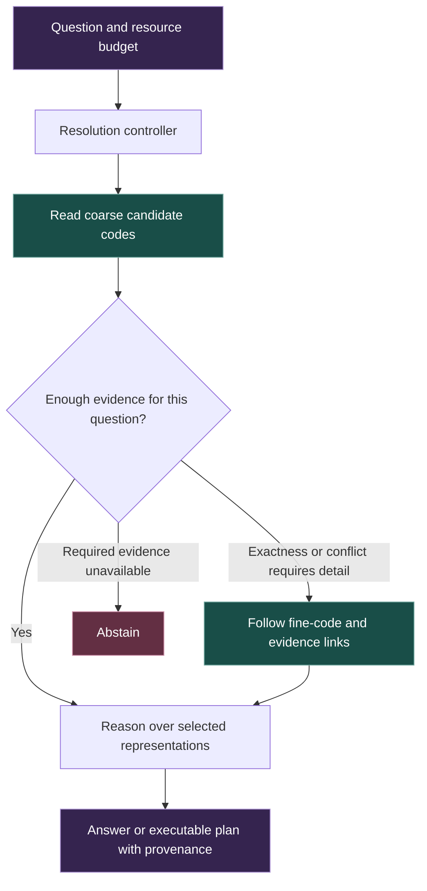
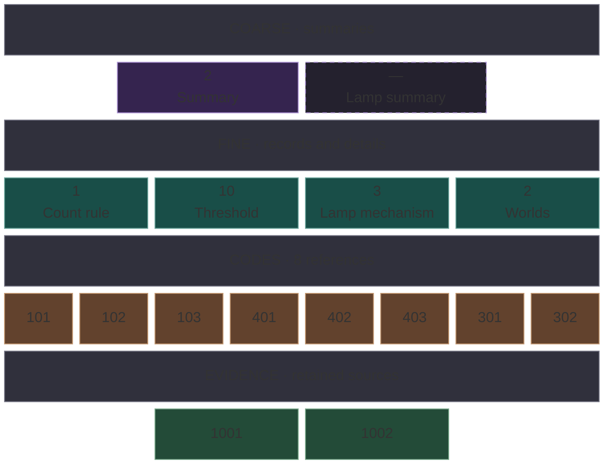
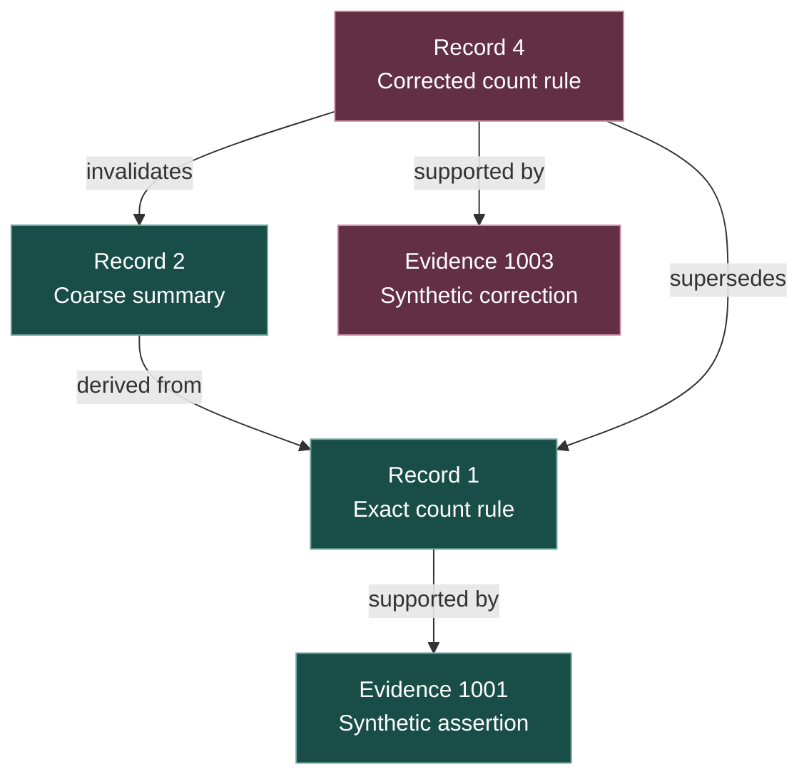
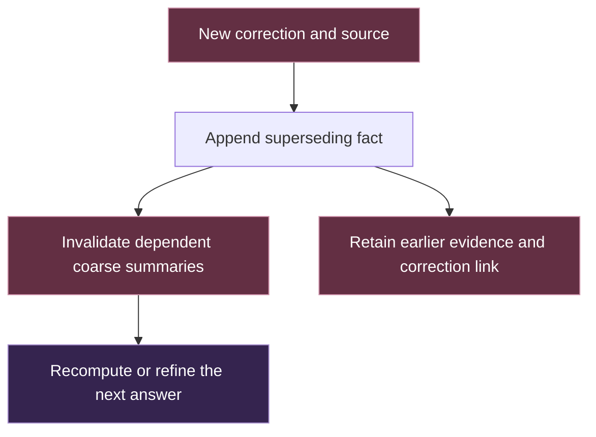
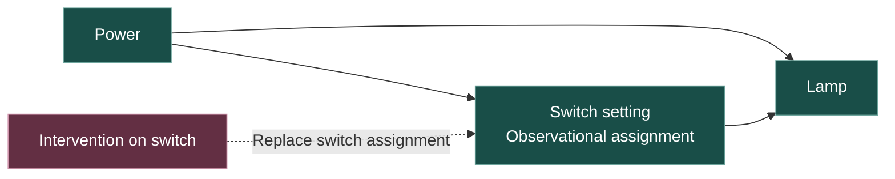

# Hierarchical memory

The memory proposal gives L.O.R.E. a persistent store with several levels of detail. A query would use the coarsest representation that preserves the information it needs, with exact values and evidence available through refinement links.

[Try the offline memory demo](../demo/memory.html). It uses synthetic fixtures, numeric codes and deterministic rules to make the contract inspectable.

## Preserve detail when writing

Write-time preservation and read-time selection have different jobs. Future questions are unknown when a memory arrives. Exact values, exceptions, provenance and recoverable detail must survive even when the store also adds a coarse abstraction.

The codebook defines what a code means. Entity references and literal fields allow new episodes to combine existing concepts with new values. Each episode does not require a newly trained vocabulary item. Schema and codebook versions prevent an old ID from silently acquiring a new meaning.

## Select resolution when reading

A broad question can use a coarse description of a threshold rule. A question about equality at the threshold requires the exact comparison, literal and boundary condition. A short summary alone cannot reliably recover a discarded fact.

The learned research target would feed code embeddings directly to a memory-conditioned reasoner. Coarse-to-fine expansion could remain in code space. A text decoder would support explanations and inspection when needed.

| Component | Demonstration | Learned research target |
| --- | --- | --- |
| Codebook | Hand-authored versioned meanings | Learned encoder and compatible discrete representations |
| Resolution | Explicit query rules | Controller trained on task error and resource costs |
| Reasoning | Deterministic operations over numeric records | Reasoner using code embeddings directly |
| Explanation | Human-readable labels and traces | Optional decoder outside the required reasoning path |

## What one memory store looks like

Purple shows the stored summary and the empty lamp-summary slot. Teal shows records 1 and 3 alongside the threshold value and the number of worlds in the lamp fixture. The amber tiles are the eight code references in those records. Green shows the two evidence IDs. Tile widths follow the layers.

The initial synthetic store totals **1,365 bytes**, including 532 bytes for the shared codebook, labels, metadata, and JSON framing. The individual sizes are 135 bytes for summary 2, 168 for count rule 1, 209 for lamp mechanism 3, and 169 and 152 for evidence 1001 and 1002.

For the count rule, code 101 means Count, 102 means strict greater-than, 103 means signed i32, and 104 identifies the summary category. The literal threshold is 10. Evidence IDs identify source records, and the code IDs inside the cards identify meanings in the codebook.

## A memory knowledge graph

A summary can reference a fact, which references its evidence. A correction adds a new fact and links it to the old one so dependent summaries can be invalidated.

The numbers identify records and evidence. Code IDs inside each record identify typed meanings. The demo exposes both levels of reference.

## Apply corrections through dependencies

Continuous memory updates change stored facts and derived summaries. Training changes model parameters. These are separate operations with separate evaluation needs.

## Keep causal claims typed

The synthetic causal fixture supplies a known mechanism. Observation selects rows from the recorded distribution. An intervention changes one mechanism while preserving the specified background distribution.

The demo compares observation and intervention using its explicit structural rule. This tests the handling of evidence and interventions in that fixture. Learning mechanisms or identifying causes in real-world data would require further assumptions, data and experiments.

## Measure the full cost

| Measurement | Meaning |
| --- | --- |
| Persisted bytes | Serialized store, codebook, records, exact values, metadata and evidence |
| Selected code references | References read for the current query |
| Rule work | Counted deterministic operations used to answer |
| Model positions and inference work | Measurements for a future learned reasoner |

Fewer selected references do not establish lower total storage or learned-model savings. The prototype measures the costs it actually performs. Selected references describe the answer context. Store validation and lookup perform additional work. The fixed demo HTML and rule implementation are separate artifact bytes.

## Research context

Discrete learned representations have a precedent in VQ-VAE. Hierarchical retrieval is studied in RAPTOR. Coconut studies reasoning through continuous latent states. These support neighboring mechanisms with different representations and objectives. [VQ-VAE](https://arxiv.org/abs/1711.00937), [RAPTOR](https://arxiv.org/abs/2401.18059), [Coconut](https://arxiv.org/abs/2412.06769)

Causal interpretation requires a mechanism and assumptions about interventions. [Schölkopf, Causality for Machine Learning](https://arxiv.org/abs/1911.10500)

[Architecture](Architecture.md) · [Subsystems](Subsystems.md) · [Research plan](Research_Plan.md) · [Overview](../README.md)

## Repeat the engine checks

From the repository root, run `node demo/check_memory.mjs`. The dependency-free checks exercise resolution budgets, exact values, correction history, invalidation, schema validation, persistence roundtrips and the synthetic causal outcomes. The check command was tested with Node.js 26.
