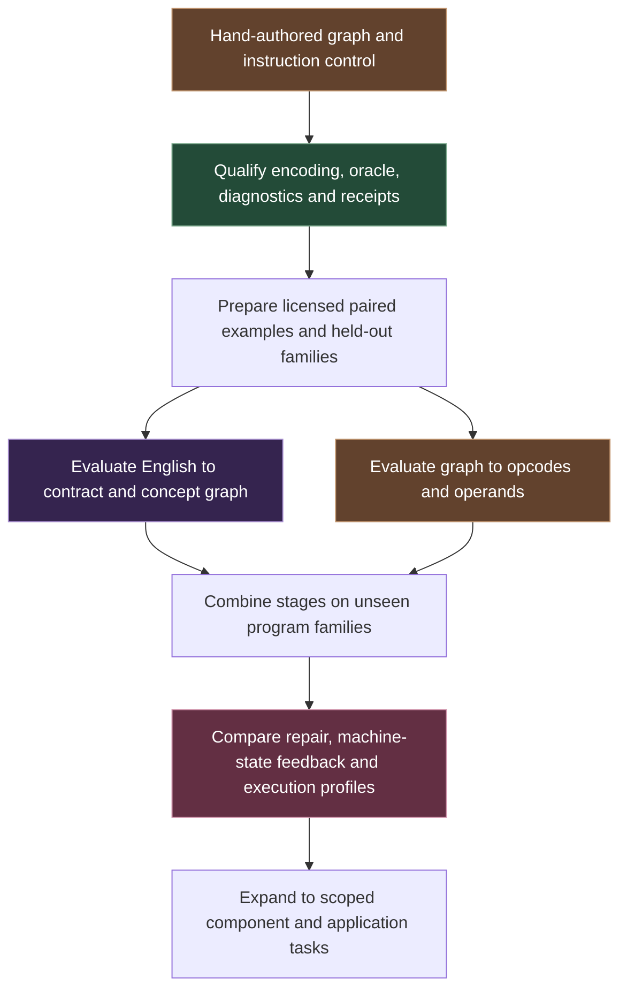

# Research plan and questions

The goal is to test whether typed hierarchical generation and learned instruction generation improve the complete path from a request to a verified executable. The program grows through explicit experiments.

## Proposed sequence

The first control has reproduced locally. The data, model and application stages are proposed research.

| Experiment | Comparison | Question |
| --- | --- | --- |
| Concept representation | Hierarchical versus flat typed generation with the same backend | Does the hierarchy improve verified success or efficiency? |
| Instruction generation | Fixed lowering versus learned instruction prediction on the same graphs | Can learned instruction choices satisfy the target contract reliably? |
| State feedback | Learned generator with versus without bounded execution-state feedback | Does feedback improve repair under a matched budget? |
| Scheduling | Serial, batched and distributed ready-branch refinement | Do saved critical-path rounds outweigh coordination and join costs? |
| Practical baseline | Complete L.O.R.E. path versus source generation plus compilation | Does the full workflow improve cost or latency at comparable correctness? |

Treat component reuse and caching as separate factors. Fresh-generation results require a fresh component. Account for retries, failed runs, model inference, graph checks, encoding, runtime startup, execution, and receipt creation.

## Data and evaluation

Start with owned synthetic kernels or inputs whose licenses permit the intended use. Each record would connect an English request, behavioral contract, typed graph, structured instruction trace, binary hash and independent test outcomes. Compiler traces can provide teacher data or comparison evidence.

Related variants, paraphrases and compositions belong in one split. Hold out complete program families. Keep the evaluation oracle independent from generation and repair feedback. Freeze the main-study success criteria, effect size and sample size before evaluating the final system.

Primary measurements are verified completion and incorrect acceptance. Report end-to-end time and compute per correct artifact alongside failure rates. Record cold and warm conditions, exact model and toolchain versions, hardware, and the total work from every attempt. Measure energy when instrumentation permits it.

## Reasons to revise or stop

Reconsider the design if the oracle is unreliable, graphs add more overhead than useful constraint, learned instructions frequently fail validation, or partial regeneration breaks surrounding components. Parallel execution needs to earn its coordination costs. A failed or inconclusive comparison is evidence for changing the approach.

## Feedback that would help

- Which stage should be tested first to expose a flaw in the premise?
- Which prior systems are the closest architectural comparisons?
- What workload would distinguish a useful representation from a convenient encoding?
- Which constraints should be enforced while decoding, at joins, or during execution?
- What fairness conditions would you require for the baseline comparison?
- What result would persuade you to continue, simplify, or stop?

[Architecture](Architecture.md) · [Concept](Concept.md) · [Current limits](Limits.md) · [Overview](../README.md)

Advanced model, training and core implementation details are reserved for internal research. [Technical disclosure and contact](Access.md)

[Visual subsystem guide](Subsystems.md) · [Research foundations](Research_Foundations.md)

## Memory and learning experiments

Compare flat retrieval, hierarchical retrieval and selected numeric records on the same synthetic facts and questions. Evaluate exact values, contradictions, correction propagation and abstention. The learned path would then compare codebook/reasoner/controller choices while holding the evidence and task budget fixed.

Report total persisted storage separately from active model positions, selected references and inference work. Evaluate memory updates separately from weight updates. Use known synthetic mechanisms before interpreting observational records as causal evidence. [Memory architecture and demonstration](Memory.md)
