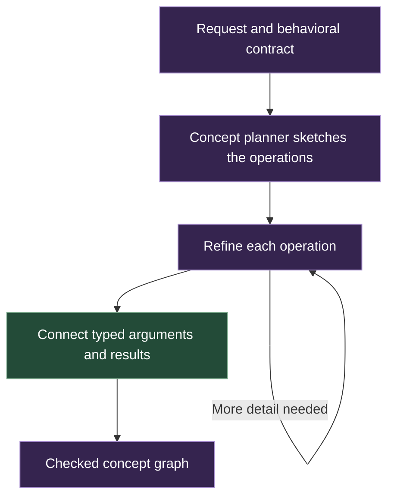
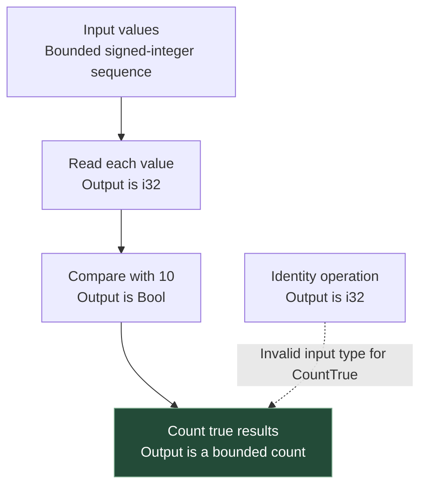
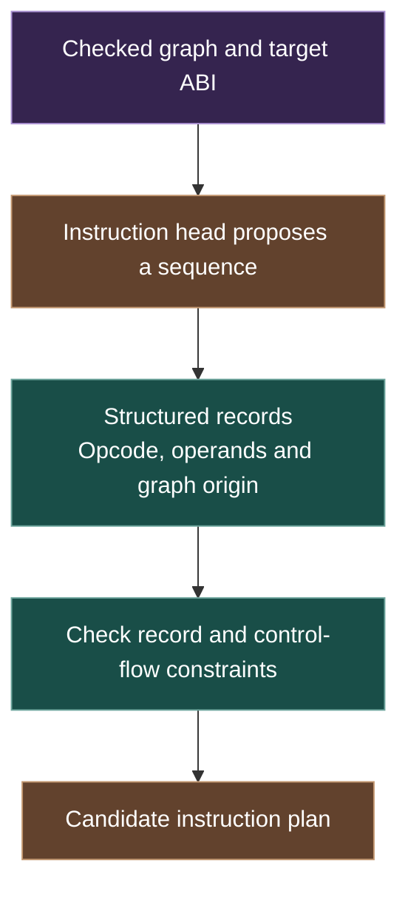
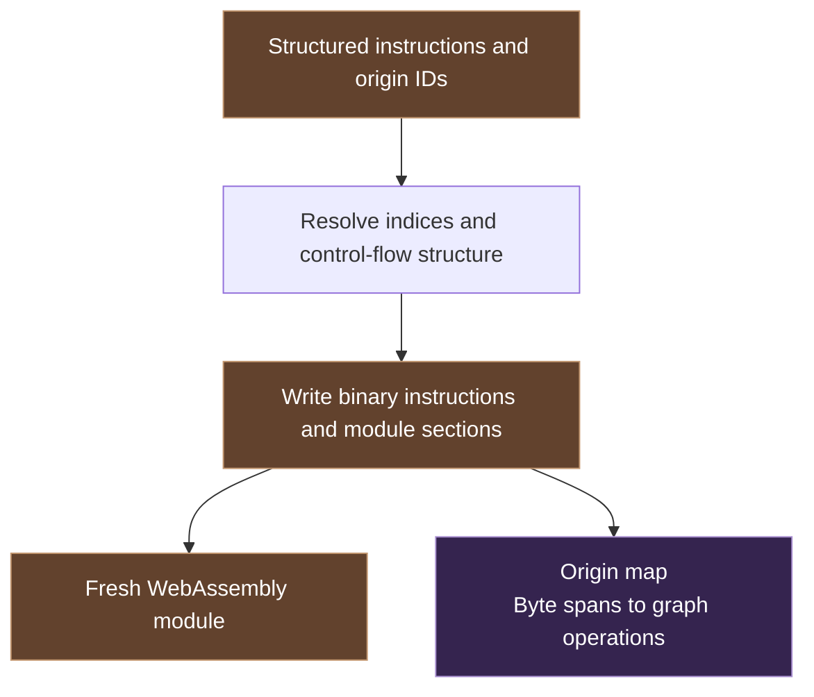
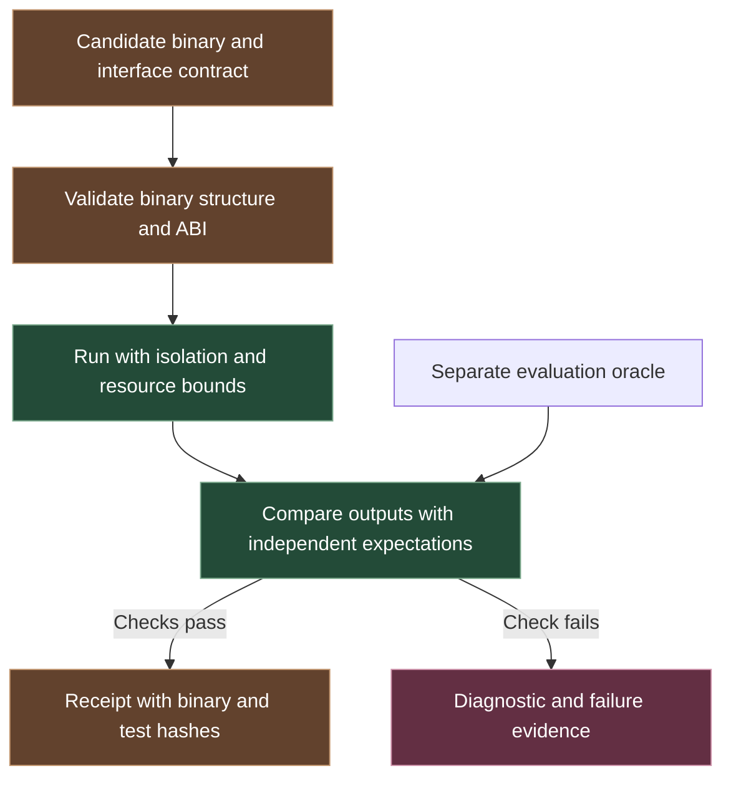
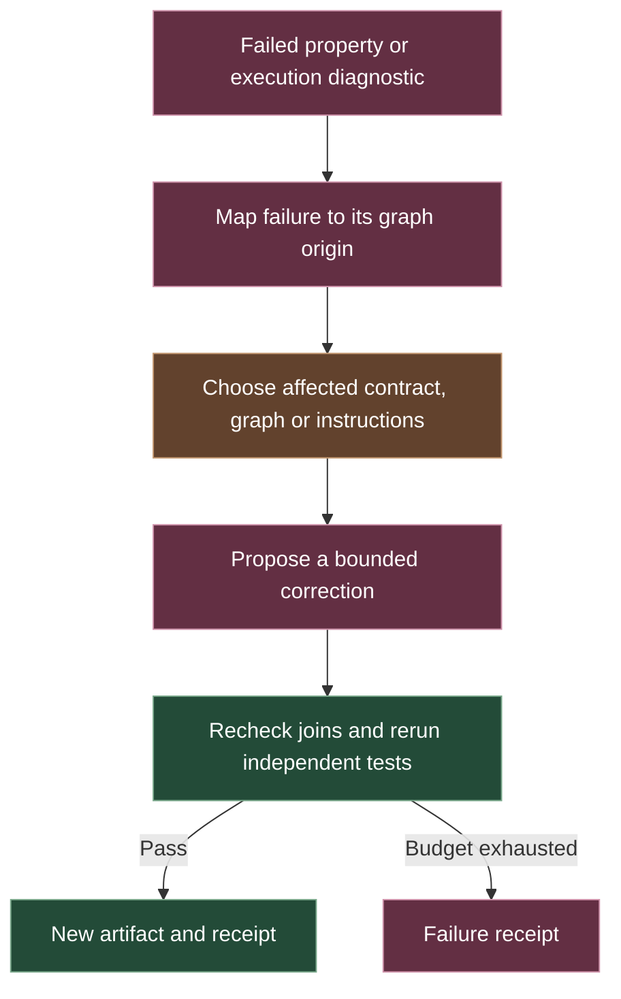

# Subsystems at a glance

L.O.R.E. connects semantic planning, instruction generation, binary encoding and independent evaluation. The diagrams on this page describe the intended interfaces. The tested control supplies a concrete example at the same boundaries.

[What is NCM?](#1-ncm) · [Typed graph](#2-the-typed-graph) · [Instruction head](#3-the-instruction-head) · [Encoder](#4-the-deterministic-encoder) · [Verifier](#5-the-verifier-and-receipt) · [Repair](#6-diagnostic-feedback)

## 1. NCM

**Next-Concept Modeling (NCM)** is a published coarse-to-fine text-generation method. Its learned code hierarchy is explained in the [concept pyramid](Concept_Hierarchy.md). L.O.R.E.'s proposed planner instead expresses program operations and their relationships as an explicit typed graph. The interface below shows that program-planning role.

For “count values above 10,” the concepts are a bounded input, a signed comparison and a count reduction. Evaluating a learned concept planner is part of L.O.R.E.'s research program. The published NCM text generator and this proposed program planner require separate evaluations.

## 2. The typed graph

A typed graph describes what values each operation accepts and produces. These explicit interfaces let a checker reject incompatible components before binary generation.

The predicate and counter must agree on Bool. The input bound also constrains the count and loop. An integer-producing branch fails at this join even when that branch makes sense on its own. The pilot exercised this rejection.

## 3. The instruction head

The proposed instruction head translates a checked graph into a structured execution plan for a chosen target. It predicts opcodes and operands within the allowed instruction vocabulary.

In the count example, the sequence needs a load, signed comparison, running sum, index update and loop. The fixed pilot fixture makes those choices by hand. A learned head would have to generate valid sequences on new tasks and pass the same independent evaluation.

## 4. The deterministic encoder

The encoder turns accepted instruction records into the target's binary format. It resolves references and writes the module's required metadata. It also preserves the connection between instruction locations and graph origins.

This boundary separates algorithm and instruction choices from byte serialization. The pilot emitted a fresh module directly from its fixture and reproduced it byte for byte.

## 5. The verifier and receipt

Verification asks whether the binary is admissible and whether its observed behavior matches the evaluation contract. The receipt connects those observations to an exact artifact.

The original harness used Wasmi and an isolated worker. The browser demonstration runs the accepted prebuilt module with reader-supplied inputs. A passing test receipt applies to its recorded checks and environment. It is evidence of those observations, with coverage determined by the evaluation suite.

## 6. Diagnostic feedback

The origin map lets a failure point back to the decision that produced it. A future repair loop could update a contract, graph node, shared interface or instruction sequence within an explicit budget.

The state-feedback experiment would compare a generator with and without compact execution-state observations. The pilot demonstrated diagnostic localization and manual restoration of known fixtures. Automatic repair remains an experiment.

[System architecture](Architecture.md) · [Research plan](Research_Plan.md) · [Technical disclosure](Access.md) · [Overview](../README.md)

## 7. Hierarchical memory

A memory controller selects coarse or fine codes for the question, preserves exact values and follows evidence links. The demonstration uses deterministic numeric operations. The learned research target would reason directly over code embeddings. [Visual memory design](Memory.md) · [Run the memory demo](../demo/memory.html)
